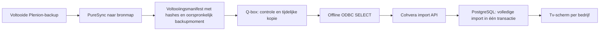

# Eigen Plenion-verwerking voor de tv-tool

Voor de **eenvoudige rechtstreekse serververbinding op de ARM64-Q-box**, zie [server/README.md](server/README.md). Die lezer heeft geen bronbackup nodig en haalt eerst projectrecords naar een lokaal JSON-bestand. De onderstaande pipeline gaat over de afzonderlijke offline-backuproute.

Deze code wordt onderhouden in de qbox-connector-repository onder `plenion/`. De Python-worker draait op de Q-box; Nest/Next en PostgreSQL draaien op de Cohvera-server. De worker gebruikt geen Synology Data Hub API en heeft geen Overlayer nodig. De bestaande LoxBerry-plugin gebruikt nog de JSON-exportconnector; de nieuwe readers zijn standalone en worden niet automatisch in het pluginscherm geactiveerd.

## Status en grenzen

Geïmplementeerd: bevestigde bestandsset kopiëren, hashes en stabiliteit controleren, offline iODBC uitlezen, projectvelden normaliseren, volledige import via HTTPS, behoud van laatste bevestiging, systemd-planning en bronoverzicht in **Tools → Tv-scherm → Gegevensverbinding**.

Lokaal getest met tijdelijke bestanden en een nagebootste reader/ontvanger. De echte HFSQL-driver, WDD-analyse en Plenion-veldselectie zijn NIET tegen productie getest. `config.example.json` bevat bewust `REPLACE_`-waarden: de worker stopt daarmee. Dit is geen direct installeerbare vervanging zonder bronconfiguratie. Er worden geen voertuigen, artikelen of NAS-metingen door deze nieuwe worker geïmporteerd; dit traject verwerkt projecten voor het tv-scherm.

De code is gericht op een Linux x86_64-Q-box met Python 3.10+, iODBC en de gelicentieerde officiële Linux HFSQL-runtime. Lever de driver met zijn bijhorende runtimebibliotheken aan onder `/opt/pcsoft`; driverbinaries en echte brongegevens horen niet in Git. De bestaande ARM-Q-box kan deze x86-driver niet native gebruiken.

## Datastroom



PureSync zelf wordt niet door deze code geconfigureerd. Laat eerst de bestaande bronmap read-only beschikbaar zijn op de Q-box; daarna kan PureSync rechtstreeks naar die map aanleveren. De worker opent alleen de kopie, niet de live Plenion-database. Een stabiele set bestanden is niet automatisch een database-consistente backup: de producer moet een geslaagde, consistente backup leveren.

## 1. Cohvera-server — Portal-map

Deploy de wijzigingen met de normale Portal-procedure. Pas de Prisma-migratie `20261012170000_qbox_capture` toe vóór het starten van de nieuwe API. Met de bestaande Compose-installatie:

```sh
cd /root/Portal
git pull
# Gebruik de gebruikelijke mergeprocedure als jouw serverbranch afwijkt.
docker compose -f docker-compose.yml -f docker-compose.warehouse.yml up -d --build api web
```

De Compose-configuratie in de Portal-repository heeft een `migrate`-service die `prisma migrate deploy` uitvoert vóór de API start. Bij een afwijkende deployment moet je dit zelf uitvoeren; de nieuwe kolommen `QboxImport.sourceKind` en `captureSha256` zijn vereist. De Q-box gebruikt dezelfde `QBOX_IMPORT_API_KEY` als Portal. Het doelbedrijf blijft server-side `QBOX_IMPORT_COMPANY`; een payload kan geen ander bedrijf kiezen. Meerdere gelijktijdige bedrijven met aparte Q-box-sleutels zijn nog niet geïmplementeerd.

API-contract v4 accepteert `source_kind=qbox_capture`, het echte bronmoment, een complete projectlijst en een capture-hash. Oudere importversies mogen een eenmaal geaccepteerde v4-import niet overschrijven. Een hash is traceerbaarheid, geen onafhankelijke verificatie door de portal van de originele bestanden. De geauthenticeerde Q-box voert die controle uit.

## 2. Q-box — bestanden installeren

Kopieer deze map vanaf je ontwikkelmachine naar de Q-box. Installeer de bestanden als beheerder onder `/opt/cohvera-plenion`, alleen schrijfbaar door root. Maak vervolgens:

```sh
sudo install -d -m 700 /etc/cohvera-plenion
sudo install -d -o loxberry -g loxberry -m 700 /var/lib/cohvera-plenion
sudo cp /opt/cohvera-plenion/config.example.json /etc/cohvera-plenion/config.json
sudo chown root:loxberry /etc/cohvera-plenion /etc/cohvera-plenion/config.json
sudo chmod 750 /etc/cohvera-plenion
sudo chmod 640 /etc/cohvera-plenion/config.json
sudo nano /etc/cohvera-plenion/config.json
sudo nano /etc/cohvera-plenion/secret.env
sudo chmod 600 /etc/cohvera-plenion/secret.env
```

In `secret.env`: `QBOX_IMPORT_API_KEY=` gevolgd door je bestaande importsleutel. Deel dit bestand niet. Pas de bronmount, analysebestand en volledige bestandslijst aan. De bron is standaard `/srv/plenion-incoming`. Als je dit wijzigt, pas ook `RequiresMountsFor` en `ReadOnlyPaths` in de service aan. De werkmap is `/var/lib/cohvera-plenion`.

## 3. Bronbackup bevestigen

Na een geslaagde consistente backup EN voltooide PureSync-overdracht moet de producer `backup-complete.json` als laatste publiceren. De inhoud bestaat uit:

```json
{"complete":true,"completed_at":"2026-10-12T01:02:00+02:00","files":{"PROJ.fic":"<64 hex SHA-256 tekens>"}}
```

De lijst moet exact overeenkomen met `required_files`, inclusief de nodige index-, memo-, klant-, status- en analysebestanden. Vul geen geschatte lijst in. De worker controleert elk bestand tegen dit manifest en controleert de bron opnieuw na kopiëren. Zorg dat gebruiker `loxberry` alle bronbestanden en het manifest kan lezen. De helper schrijft het manifest met modus 600; als de producer een andere gebruiker is, geef daarna gericht leesrecht aan de groep van de Q-box-worker (bijvoorbeeld root:loxberry, modus 640).

Een helper voor een succesvolle producer-hook is beschikbaar:

```sh
python3 seal_backup.py --config /pad/naar/producer-config.json --completed-at "$BACKUP_COMPLETED_AT"
```

`BACKUP_COMPLETED_AT` moet afkomstig zijn van de werkelijke bronbackup, niet het moment van opnieuw kopiëren of herimporteren. De helper moet uitgevoerd worden waar de voltooide backup staat en schrijfrecht op de bronmap bestaat; de gewone Q-box-service heeft dat recht juist niet. De helper bewijst zelf geen databaseconsistentie. Zonder betrouwbaar voltooiingsmoment of manifest wordt niets geïmporteerd. De voorbeeldtijd hierboven is illustratief en wordt als verouderd geweigerd.

## 4. HFSQL-velden configureren

De offline verbinding moet `RepFic={capture}` bevatten en mag geen Server/DSN gebruiken. `{capture}` wordt vervangen door de gecontroleerde tijdelijke kopie. Een WDD-analyse is volgens de Linux-driverdocumentatie optioneel. Als de driver die voor jouw bestanden nodig heeft, voeg het bestand toe aan `required_files` en `Analyse={capture}/jouw.wdd` aan de verbinding. Eventuele tabelwachtwoorden moeten passen bij deze bestanden; dit kan niet uit een containernaam worden afgeleid. Plaats eventuele verbindingsecrets alleen in het beschermde lokale configuratiebestand.

`projects_sql` bevat precies één SELECT met tien kolommen, in deze volgorde:

| Positie | Betekenis | Verplicht formaat |
| --- | --- | --- |
| 1 | Bronrecord-ID | Unieke niet-lege tekst |
| 2 | Projectnummer | Cijfers, als tekst |
| 3 | Klantnaam | Tekst, eventueel lege tekst |
| 4 | Omschrijving | Tekst, eventueel lege tekst |
| 5 | Plandatum | YYYY-MM-DD of lege tekst |
| 6 | Statuslabel | Volledig werkelijk bronlabel |
| 7 | Actief | 0 of 1 |
| 8 | Afgewerkt-vinkje | 0 of 1, onafhankelijk van statuslabel |
| 9 | Huidige revisie | 0 of 1, volgens echte Plenion-revisieregel |
| 10 | Revisie | Bronwaarde voor de query; niet gebruikt om willekeurig een winnaar te kiezen |

Gebruik de werkelijke tabellen en relaties om klant, status en huidige revisie te bepalen. De bekende `PROJ.IDProj`, `projnr` en `VersieNr` zijn slechts een vertrekpunt. Er wordt bewust geen aanname gemaakt dat de hoogste ID de juiste revisie is. NULL bij verplichte velden, meerdere huidige revisies, afgekapt resultaat of ODBC-fouten blokkeren publicatie.

Driverreferenties: [PC SOFT Linux ODBC-configuratie](https://doc.pcsoft.fr/fr-FR/?9000160) en [iODBC op Linux](https://blogs.pcsoft.fr/fr/pilote-odbc-hfsql-linux-penser-configurer-applications-utilisent-iodbc/362/read.awp). De offline verbindingsvorm moet nog met de aangeleverde Linux-driver en WDD worden bewezen.

## 5. Eerst lokaal valideren, daarna activeren

Na de driver- en veldconfiguratie, op de Q-box:

```sh
sudo -u loxberry env LD_LIBRARY_PATH=/opt/pcsoft python3 /opt/cohvera-plenion/pipeline.py --config /etc/cohvera-plenion/config.json --dry-run
```

Dit kopieert en leest, maar publiceert niet. Vergelijk aantallen en concrete open/afgesloten projecten met Plenion. Installeer pas daarna de service en timer:

```sh
sudo cp /opt/cohvera-plenion/cohvera-plenion.service /etc/systemd/system/
sudo cp /opt/cohvera-plenion/cohvera-plenion.timer /etc/systemd/system/
sudo systemctl daemon-reload
sudo systemctl start cohvera-plenion.service
sudo systemctl status cohvera-plenion.service --no-pager -l
sudo cat /var/lib/cohvera-plenion/last-success.json
sudo systemctl enable --now cohvera-plenion.timer
```

Een succesvolle oneshot-service mag daarna `inactive (dead)` zijn. `last-success.json` en **Gegevensverbinding** in de tv-tool moeten dezelfde batch aangeven. De timer controleert elk kwartier; dit maakt een dagelijkse backup niet live. Zet na de eerste bewezen import de oude projectaanvoer uit om dubbele pogingen te voorkomen.

## Fouten en opslag

`status.json` bevat de lokale fase; `last-success.json` verandert alleen na bevestiging door Cohvera. De portal toont de laatst geaccepteerde import, geen live worker-heartbeat. Raw kopieën en readeruitvoer worden na normale afloop of een afgevangen fout verwijderd. Bij stroomuitval/SIGKILL kunnen oude mappen onder `captures` blijven staan; inspecteer die bij onderhoud en verwijder ze alleen wanneer de service niet draait. Bronbestanden en laatst geldige portaalgegevens worden niet verwijderd.

## Tests vanuit de qbox-connector-repo

```sh
python3 -m unittest discover -s plenion -p 'test_*.py'
pnpm --filter @cohvera/api test:qbox
pnpm --filter @cohvera/api typecheck
pnpm --filter @cohvera/web typecheck
```

## Driverarchitectuur eerst controleren

De officiële Linux-handleiding noemt `wxpackodbclinux64.zip` onder `INSTALL/ODBC` van WINDEV/WEBDEV. 64-bit is geen bevestiging van ARM64. Er is in het onderzoek van 13 oktober 2026 geen expliciet als ARM64 aangeduid ODBC-pakket bevestigd. De eerder gedocumenteerde versie 30-driver is x86_64. De huidige Mac is geen Linux-Q-box; er is nog geen driver op de echte Q-box geladen.

Pak de officiële driver met de bijbehorende runtimebibliotheken uit. Voer eerst zonder sudo uit op de Q-box, met het werkelijke driverpad:

```sh
python3 check_driver.py /pad/naar/wd300hfo64.so
python3 check_driver.py /pad/naar/wd300hfo64.so --load
```

De eerste opdracht leest alleen de ELF-header. De tweede laadt een vertrouwde officiële driver uitsluitend bij overeenkomende Linux-architectuur, in een apart proces met 20 seconden tijdslimiet. Dit controleert bibliotheken en ODBC-symbolen, maar maakt geen databaseverbinding. Een x86_64-driver op aarch64 wordt duidelijk geweigerd. Python/iODBC en driver moeten binnen hetzelfde proces dezelfde architectuur hebben. Emulatie van een volledige x86_64-runtime is een aparte route; `--load` installeert geen emulatie.
